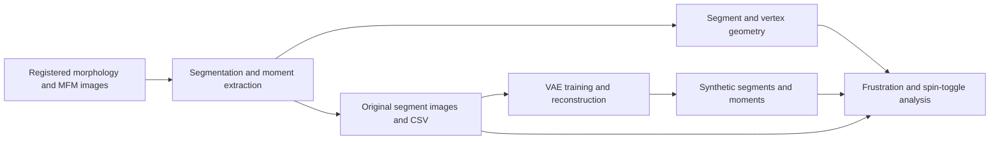

# Working through the notebooks

This execution order is inferred from the notebook source and its file dependencies. Full training and paper-figure reproduction have not been rerun as part of source preparation.

## Common stages

1. **Segment the nanomagnets and estimate moments.** Use a morphology/mask image to locate nanomagnets, crop the registered MFM image, and infer moment directions and relative strengths. Save the segment images and moment CSV.
2. **Train the VAE and reconstruct segments.** Load the segment images and CSV, resize/pad to 64 × 64 RGB, split the dataset, train the fully connected VAE, and save reconstructed segments. Later cells estimate synthetic moments and reconstruct the full image.
3. **Analyze vertices and frustration.** Use original segment geometry and the moment tables to find candidate vertices, classify magnetic configurations, and explore direction reversals.

## Compact sequence: `mfm_frust_set2/`

Provide `p90mtmor.png` and `p90mtphase.png` in this directory, then open:

1. `Automate_strength_direction.ipynb`
2. `VAE_generate_image.ipynb`
3. `Predict_frustration_synthetic.ipynb`

The VAE expects `mfm_segments/` and `mfm_segments_with_arrows/magnetic_moments.csv`; the frustration notebook expects both original and synthetic moment tables and the segmentation image. Execute all prerequisite stages before the corresponding analysis cells. Review the [limitations](REPRODUCIBILITY.md), especially the CSV-to-segment mapping and the one-batch validation export, even for this compact sequence.

## Detailed analyses: `mfm_image1/`

Provide the `AB1.png`, `AB2.png`, and `AB3.png` input images. The principal notebooks are:

1. `Automate_strength_direction_magnetic_moment.ipynb`
2. `VAE_generative_image.ipynb`
3. `Predict_frustration_orginal_mfm.ipynb`
4. `Predict_frustration_synthetic_mfm.ipynb`

Both frustration notebooks load the synthetic CSV in their setup/inspection cells, so run the VAE stage first even when inspecting original-image frustration.

Several saved versions use different names for the same stage's outputs. Before running the public copies, align these paths consistently throughout the relevant notebooks:

| Producer / consumer | Current path difference |
| --- | --- |
| Segmentation → VAE | Segmentation writes `mfm_segments_with_arrows_arrow_color_updated/magnetic_moments.csv`; the VAE reads `mfm_segments_with_directional_arrows/magnetic_moments.csv` |
| Segmentation → frustration | Frustration notebooks read `mfm_segments_with_arrows/` |
| VAE → frustration | VAE arrow generation writes `synthetic_mfm_segments_with_arrows_updated_arrow_color/`; frustration reads `synthetic_mfm_segments_with_arrows/` |
| VAE reconstruction → image comparisons | A reconstruction cell saves `reconstructed_synthetic_mfm_image_with_directional_updated_arrows.png`; comparison cells also refer to `reconstructed_synthetic_mfm_image_with_directional_arrows.png` |

For a fresh run, using `mfm_segments_with_arrows/`, `synthetic_mfm_segments_with_arrows/`, and `reconstructed_synthetic_mfm_image_with_directional_arrows.png` consistently is one option. Choose one naming convention for that run; the archived source names have been preserved rather than assuming that existing results from different variants are equivalent.

`Highlight_artifacts.ipynb` is an additional inspection step. `cleaned_code.py` is an earlier standalone preprocessing variant with top-level execution and different intermediate-directory assumptions; it is not a packaged command-line entry point.

## Relaxed configuration: `mfm_relax_set1/`

Provide `relax_mor.png` and `relax.png`, then inspect:

1. `Automate_strength_direction.ipynb`
2. `VAE_generate_image.ipynb`
3. `Frustration_prediction.ipynb`

The segmentation version writes `mfm_segments_with_updated_arrow_colors/`, whereas the VAE and frustration analysis refer to `mfm_segments_with_arrows/`. The reconstruction and classification cells also use several `paper_fig` and updated-arrow filenames. Align each required image/CSV path with the output from the chosen preceding stage. The VAE notebook includes training-loss, latent-space, and further evaluation experiments; some later cells depend on earlier interactive state.

## Execution details

Use the notebook's containing directory as the kernel working directory. In Jupyter, verify with `Path.cwd()` after importing `Path` from `pathlib`. Restart the kernel when changing datasets or switching between notebook variants so that variables from a previous experiment do not hide missing prerequisites.

Training defaults are 100 epochs, batch size 64, hidden dimension 400, Adam learning rate 0.005, and an 80/20 random split for the five main MFM VAE notebooks. Their instantiated latent dimension is 60. Their loss is summed binary cross-entropy plus KL divergence, equivalent to a KL weight of one.

Save your selected parameters, package versions, random seeds, split indices, and model weights alongside any new results. Generated files are ignored by Git. Before committing an edited notebook, clear its outputs with `python scripts/clean_notebooks.py` from the repository root.
